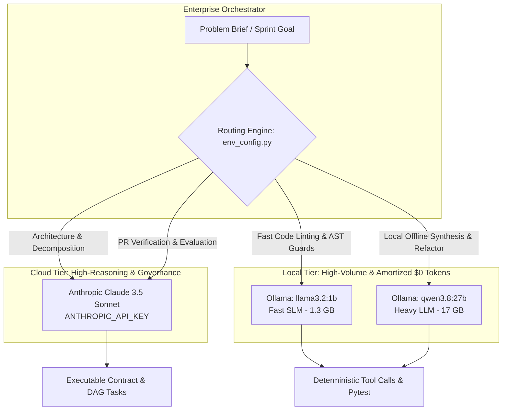
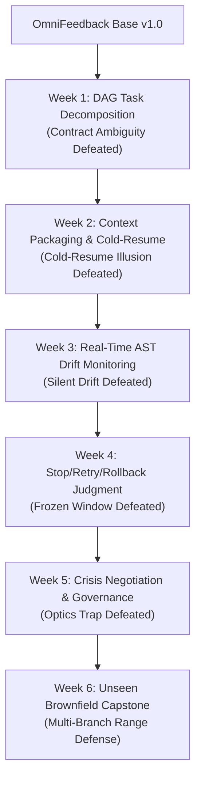

# 🏢 AI Agents Orchestrator — Enterprise Major Labs Hub
## Standardized Multi-Week Production Lab Repository for UST Global Engineering

**Target Audience**: Senior Developers, Technical Leads, and Enterprise Solutions Architects at UST  
**Reference Enterprise Application**: `OmniFeedback Sentinel` (Distributed Multi-Tenant Sentiment Microservice)  
**Curriculum Scope**: Weeks 1 through 6 (Days 01 through 18)  
**Primary Repository Location**: `TrainingContent/Labs/` (Symlinked / Junctioned to `/Labs`)

---

## 🧭 Executive Introduction & Purpose

Traditional AI coding tutorials treat language models like chat buddies or omniscient code generators: an engineer opens an editor, types a loose natural-language prompt like *"Add rate limiting to my API"*, blindly pastes 300 lines of unverified code, and spends the next three sprints debugging silent race conditions, security regressions, and broken backward compatibility.

In high-stakes enterprise environments at UST, **code generation is cheap; verification, architectural containment, and zero-defect governance are expensive**.

This **Major Labs Hub** provides a complete, production-grade laboratory environment where participants learn how to build the deterministic software scaffolding, Directed Acyclic Graph (DAG) task decompositions, strict I/O contracts, AST drift monitors, and automated rollback circuit breakers that make AI coding agents safe to deploy on mission-critical microservices.

---

## 🛠️ Multi-Tool Execution Guides (200+ UST Cohort)

Every participant must select and configure their enterprise toolchain before beginning lab sprints:
- **First-Principles Demo**: [`scratch_agent_demo.py`](scratch_agent_demo.py) (The 25-line runnable scratch agent loop)
- **Claude Code Guide**: [`TOOL_GUIDE_CLAUDE_CODE.md`](TOOL_GUIDE_CLAUDE_CODE.md) (Anthropic CLI, `CLAUDE.md`, `/compact`, `/cost`, `/clear`)
- **Cursor IDE Guide**: [`TOOL_GUIDE_CURSOR.md`](TOOL_GUIDE_CURSOR.md) (`.cursorrules`, Composer Agent Mode, `@Files`, `@Git`)
- **Google Antigravity Guide**: [`TOOL_GUIDE_ANTIGRAVITY.md`](TOOL_GUIDE_ANTIGRAVITY.md) (`rules/`, `AGENTS.md`, subagents, task tracking)
- **Tool Comparison & Setup**: [`TOOL_SETUP_AND_COMPARISON.md`](TOOL_SETUP_AND_COMPARISON.md) (Side-by-side architecture matrix)

---

## 🤖 Multi-Provider Hybrid Architecture: Anthropic API Key + Existing Local Ollama

The entire lab curriculum uses a **production-grade enterprise hybrid topology**:



### 1. Configuration in `.env`
Both root and `Labs/` contain a master [`.env`](.env) file:
```ini
# Cloud Architect Tier (Vendor Key)
ANTHROPIC_API_KEY=sk-ant-api03-...
ANTHROPIC_MODEL=claude-3-5-sonnet-20241022

# Local Open-Source Worker Tier (Your Active Ollama Models)
OLLAMA_BASE_URL=http://localhost:11434
OLLAMA_MODEL=llama3.2:1b
OLLAMA_FAST_MODEL=llama3.2:1b
OLLAMA_REASONING_MODEL=qwen3.8:27b

# Enterprise Routing Policy
DEFAULT_LLM_PROVIDER=hybrid
```

### 2. Active Model Roles
- **Anthropic Claude 3.5 Sonnet**: Acts as the **Architect & Reviewer**. Decomposes ambiguity into Directed Acyclic Graphs (DAG), drafts Architecture Decision Records (ADRs), and conducts rigorous safety audits.
- **`llama3.2:1b` (Ollama)**: Acts as the **Fast Worker & Guardrail Sentinel**. Handles high-frequency tasks such as AST invariant validation, prompt injection screening, and test output parsing in milliseconds with $0 incremental cost.
- **`qwen3.8:27b` (Ollama)**: Acts as the **Deep Worker**. Handles complex offline code generation, module refactoring, and multi-file dependency updates.
- **Offline Fallback**: When offline or in air-gapped CI environments, all modules automatically fall back to deterministic contract simulation, keeping all test suites 100% green.

### 3. Quick Hybrid Test Command
Verify both Anthropic and your local Ollama models in action:
```powershell
python scratch_agent_demo.py
```

---

## 🐙 GitHub Publishing, Repository Architecture & Cohort Sharing

Before assigning labs to participants, the administrator or trainer publishes this repository:
- **Master Cohort Sharing Guide**: [`GITHUB_DISTRIBUTION_AND_SHARING_GUIDE.md`](GITHUB_DISTRIBUTION_AND_SHARING_GUIDE.md) (Complete guide on GitHub Template Repositories, Forks, and Offline Air-Gapped Zip Bundles).
- **Publish to GitHub (Windows PowerShell)**: `.\init_github_repository.ps1 -RemoteUrl "https://github.com/<org>/ai-agents-orchestrator-labs.git"`
- **Publish to GitHub (Mac/Linux Bash)**: `./init_github_repository.sh "https://github.com/<org>/ai-agents-orchestrator-labs.git"`
- **Offline Firewall Zip Packager**: `python package_offline_labs_bundle.py` (Generates `ust_ai_agents_orchestrator_labs.zip` with embedded `.git` repository).
- **Automated GitHub Actions CI**: [`.github/workflows/verify-labs.yml`](.github/workflows/verify-labs.yml) (Runs pytest on all 6 labs automatically).
- **Pull Request Template**: [`.github/PULL_REQUEST_TEMPLATE.md`](.github/PULL_REQUEST_TEMPLATE.md) (Structured verification checklist).

---

## 🏗️ Part 1: How to Build the Base Enterprise Project from Scratch

Every lab in this curriculum runs against the **OmniFeedback Sentinel** microservice. Below are the exact step-by-step instructions to create this base project from absolute first principles.

### Step 1.1: Project Directory Structure
Create a dedicated folder and structure the project following modern 12-factor microservice standards:

```bash
mkdir -p OmniFeedback_Sentinel/{api,core,models,tests}
cd OmniFeedback_Sentinel
```

The resulting directory tree:
```
OmniFeedback_Sentinel/
├── api/
│   └── app.py                 # FastAPI routing, middleware, lifecycle handlers
├── core/
│   ├── config.py              # Application settings and tenant quota definitions
│   └── rate_limiter.py        # Token-bucket rate limiting engine
├── models/
│   ├── feedback.py            # Strict Pydantic I/O validation schemas
│   └── tenant.py              # Tenant credentials and tier domain models
├── tests/
│   ├── test_feedback.py       # API endpoint validation and security tests
│   └── test_rate_limiter.py   # Multi-tenant rate limit and burst tests
└── requirements.txt
```

### Step 1.2: Dependencies (`requirements.txt`)
Create `requirements.txt` with minimal, highly stable dependencies:
```text
fastapi>=0.100.0
pydantic>=2.0.0
pytest>=7.0.0
httpx>=0.24.0
pytest-asyncio>=0.21.0
```

Install via terminal:
```bash
python -m venv venv
# On Windows PowerShell:
.env\Scripts\Activate.ps1
# On macOS/Linux:
source venv/bin/activate

pip install -r requirements.txt
```

### Step 1.3: Core Domain Models (`models/tenant.py` and `models/feedback.py`)

#### `models/tenant.py`
```python
from typing import Literal
from pydantic import BaseModel, Field

class TenantQuota(BaseModel):
    tenant_id: str = Field(..., description="Unique alphanumeric tenant slug")
    tier: Literal["free", "standard", "enterprise"] = Field(default="standard")
    requests_per_minute: int = Field(default=60, ge=1)
    burst_capacity: int = Field(default=10, ge=1)
```

#### `models/feedback.py`
```python
import re
from datetime import datetime, timezone
from typing import Optional
from pydantic import BaseModel, Field, field_validator

EMAIL_REGEX = re.compile(r"^[\w\.-]+@[\w\.-]+\.\w+$")

class FeedbackSubmission(BaseModel):
    tenant_id: str = Field(..., min_length=3, max_length=50)
    user_email: str = Field(..., description="Valid contact email")
    rating: int = Field(..., ge=1, le=5, description="1 to 5 customer satisfaction score")
    comment: str = Field(..., min_length=5, max_length=1000)
    source_channel: str = Field(default="web")
    created_at: datetime = Field(default_factory=lambda: datetime.now(timezone.utc))

    @field_validator("user_email")
    def validate_user_email(cls, v: str) -> str:
        if not EMAIL_REGEX.match(v):
            raise ValueError(f"Invalid email address format: {v}")
        return v.lower()

class FeedbackResponse(BaseModel):
    feedback_id: str
    status: Literal["accepted", "queued", "flagged"]
    received_at: datetime
    sentiment_tag: Optional[str] = None
```

### Step 1.4: In-Memory Token Bucket Limiter (`core/rate_limiter.py`)
```python
import time
from typing import Dict, Tuple

class TokenBucketRateLimiter:
    def __init__(self):
        # Maps tenant_id -> (current_tokens, last_refill_timestamp)
        self._buckets: Dict[str, Tuple[float, float]] = {}

    def is_allowed(self, tenant_id: str, rate_per_minute: int, burst_capacity: int) -> bool:
        now = time.time()
        refill_rate = rate_per_minute / 60.0  # Tokens per second

        if tenant_id not in self._buckets:
            # New bucket starts full at burst capacity
            self._buckets[tenant_id] = (float(burst_capacity) - 1.0, now)
            return True

        current_tokens, last_refill = self._buckets[tenant_id]
        time_passed = now - last_refill
        replenished = current_tokens + (time_passed * refill_rate)
        current_tokens = min(float(burst_capacity), replenished)

        if current_tokens >= 1.0:
            self._buckets[tenant_id] = (current_tokens - 1.0, now)
            return True
        else:
            self._buckets[tenant_id] = (current_tokens, now)
            return False

rate_limiter_instance = TokenBucketRateLimiter()
```

### Step 1.5: Application Gateway & Middleware (`api/app.py`)
```python
import uuid
from datetime import datetime, timezone
from fastapi import FastAPI, Header, HTTPException, Request, Response, status
from models.feedback import FeedbackSubmission, FeedbackResponse
from core.rate_limiter import rate_limiter_instance
from models.tenant import TenantQuota

app = FastAPI(title="OmniFeedback Sentinel", version="1.0.0")

TENANT_TIERS = {
    "tenant_free": TenantQuota(tenant_id="tenant_free", tier="free", requests_per_minute=10, burst_capacity=2),
    "tenant_standard": TenantQuota(tenant_id="tenant_standard", tier="standard", requests_per_minute=60, burst_capacity=10),
    "tenant_enterprise": TenantQuota(tenant_id="tenant_enterprise", tier="enterprise", requests_per_minute=600, burst_capacity=100),
}

@app.middleware("http")
async def rate_limit_middleware(request: Request, call_next):
    if request.url.path.startswith("/api/v1/feedback"):
        tenant_id = request.headers.get("X-Tenant-ID")
        if not tenant_id:
            return Response(content='{"detail": "Missing X-Tenant-ID header"}', status_code=401, media_type="application/json")
        
        quota = TENANT_TIERS.get(tenant_id, TenantQuota(tenant_id=tenant_id, tier="standard", requests_per_minute=60, burst_capacity=5))
        allowed = rate_limiter_instance.is_allowed(tenant_id, quota.requests_per_minute, quota.burst_capacity)
        if not allowed:
            return Response(
                content='{"detail": "Tenant quota exceeded. HTTP 429 Too Many Requests"}',
                status_code=429,
                media_type="application/json",
                headers={"Retry-After": "60"}
            )
            
    response = await call_next(request)
    return response

@app.get("/healthz")
def healthz():
    return {"status": "healthy", "service": "OmniFeedback Sentinel", "version": "1.0.0"}

@app.post("/api/v1/feedback", response_model=FeedbackResponse, status_code=status.HTTP_201_CREATED)
def submit_feedback(submission: FeedbackSubmission, x_tenant_id: str = Header(..., alias="X-Tenant-ID")):
    if submission.tenant_id != x_tenant_id:
        raise HTTPException(status_code=400, detail="Tenant ID in payload does not match X-Tenant-ID header")
    
    return FeedbackResponse(
        feedback_id=f"fb_{uuid.uuid4().hex[:12]}",
        status="accepted",
        received_at=datetime.now(timezone.utc),
        sentiment_tag="neutral"
    )
```

### Step 1.6: Automated Pytest Suite (`tests/test_feedback.py` & `tests/test_rate_limiter.py`)
Run the test suite to establish the **Zero-Defect Baseline**:
```bash
pytest tests/ -v
```
Expected output:
```
tests/test_feedback.py::test_health_check PASSED
tests/test_feedback.py::test_valid_feedback_submission PASSED
tests/test_feedback.py::test_invalid_email_rejection PASSED
tests/test_rate_limiter.py::test_initial_burst_allowance PASSED
tests/test_rate_limiter.py::test_rate_limit_throttle_trigger PASSED
tests/test_rate_limiter.py::test_multi_tenant_isolation PASSED
====== 6 passed in 0.50s ======
```

---

## ⚡ Part 2: Implementing the AI Agent Orchestration Layer (Production vs. Traditional)

| Dimension | ❌ Traditional / Naive AI Prompting | 🛡️ Production AI Agent Orchestration (This Course) |
| :--- | :--- | :--- |
| **Task Definition** | One giant prompt: *"Add rate limiting and an export API."* | **Directed Acyclic Graph (DAG)** of atomic nodes with mathematical pre/post-conditions. |
| **Context Management** | Pasting 50 files into chat or huge context windows. | **Durable Context Packaging (`context_package.json`)** with Git SHAs and exact AST boundaries. |
| **Execution Boundary** | Agent edits any file it wants in the working directory. | **Isolated Git Worktrees (`git worktree add`)** with write-locks on protected files. |
| **Drift Monitoring** | Run `git diff` after the agent finishes 2 hours later. | **Real-Time AST Diff Telemetry** catching drift signals in < 30 seconds. |
| **Failure Recovery** | *"Hey model, fix the error you just made"* (hallucination loop). | **5-Minute Frozen Window Stop/Retry/Rollback Matrix** and instant `git reset --hard`. |
| **Multi-Party Governance** | Developer hides token overrun or broken tests. | **Principled Roleplay Triads** (Lead, PO, Security/Finance) with auditable logs. |

### How Each Week Operates on OmniFeedback Sentinel:



---

## 🐙 Part 3: GitHub & Git Governance Lifecycle Procedures

Senior developers must treat AI agents like untrusted external contributors. Follow this strict Git lifecycle across all labs:

### 3.1: Repository Initialization & Baseline Tagging
```bash
git init
git config user.name "UST Architect"
git config user.email "architect@ust.com"

# Create .gitignore
echo "__pycache__/
*.pyc
.pytest_cache/
venv/
worktree-*/" > .gitignore

git add .
git commit -m "chore(baseline): initial commit of OmniFeedback Sentinel v1.0.0"
git tag -a v1.0-baseline -m "Certified zero-defect starting point"
```

### 3.2: Isolated Agent Execution via Git Worktrees
Never allow an autonomous agent to execute inside your main working directory! If the agent deletes files or enters an infinite loop, your primary environment is corrupted.

```bash
# Create an isolated worktree on a dedicated branch
git worktree add ../worktree-lab01 feature/task-decomposition-dag
cd ../worktree-lab01

# The agent operates exclusively inside this isolated worktree
# ... Agent executes task ...

# Inspect changes made by the agent before accepting
git status
git diff --stat v1.0-baseline

# If successful, commit from the worktree
git add .
git commit -m "feat(orchestration): implement TASK-01 and TASK-02 with executable contracts"
git tag -a lab01-submission -m "Week 1 Graded Deliverable"

# Return to main and clean up worktree
cd ../OmniFeedback_Sentinel
git worktree remove ../worktree-lab01
```

### 3.3: Emergency Rollback Commands (When an Agent Regresses)
If an agent hallucinates unapproved dependencies or breaks core invariants:
```bash
# 1. Inspect the blast radius
git diff --name-only v1.0-baseline

# 2. Hard rollback to guaranteed green state
git clean -fd
git reset --hard v1.0-baseline

# 3. Assert baseline tests still pass 100%
pytest tests/ -v
```

---

## 📅 Part 4: Day-Wise Mapping to Major Labs

| Curriculum Day | Session Title | Primary Graded Artifact | Lab Folder Directory |
| :--- | :--- | :--- | :--- |
| **Day 01 (2026-10-22)** | Foundations – Agent Workflow & Open Source LLMs | Task Decomposition Package v1 + **Ollama Runtime** | [Lab_01_*](Lab_01_Foundations_DAG_Task_Decomposition/) |
| **Day 02 (2026-10-29)** | Guided Lab: Local LLMs & Function Calling | AI Toolchain Config (.cursorrules) | [Lab_01_*](Lab_01_Foundations_DAG_Task_Decomposition/) |
| **Day 03 (2026-11-03)** | Guided Lab: DAG Contract Construction | Validated DAG Executable Contract | [Lab_01_*](Lab_01_Foundations_DAG_Task_Decomposition/) |
| **Day 04 (2026-11-05)** | Context Packaging, MCP & RAG Architecture | Context Package + Cold-Resume | [Lab_02_*](Lab_02_Context_Packaging_MCP_Cold_Resume/) |
| **Day 05 (2026-11-10)** | Guided Lab: RAG Vector Ingestion & Indexing | RAG Vector Index (ChromaDB) | [Lab_02_*](Lab_02_Context_Packaging_MCP_Cold_Resume/) |
| **Day 06 (2026-11-11)** | Guided Lab: MCP RAG Server & Tool Binding | MCP RAG Server + Cold-Resume Result | [Lab_02_*](Lab_02_Context_Packaging_MCP_Cold_Resume/) |
| **Day 07 (2026-11-12)** | Real-Time Monitoring & Open Source Multi-Agent | Monitoring & Escalation Log | [Lab_03_*](Lab_03_Real_Time_Monitoring_Drift_Detection/) |
| **Day 08 (2026-11-17)** | Guided Lab: Multi-Agent Chore Delegation | Open Source Multi-Agent Runner | [Lab_03_*](Lab_03_Real_Time_Monitoring_Drift_Detection/) |
| **Day 09 (2026-11-18)** | Guided Lab: Git Worktree Concurrency Isolation | Collision-Free Merged PR Package | [Lab_03_*](Lab_03_Real_Time_Monitoring_Drift_Detection/) |
| **Day 10 (2026-11-19)** | Stop / Retry / Escalate & Response Evaluation | Decision Log (5-Min Window) | [Lab_04_*](Lab_04_Stop_Retry_Escalate_Judgment_Rollback/) |
| **Day 11 (2026-11-25)** | Guided Lab: RAGAS Triad Scoring & Assertions | RAGAS Evaluation Test Suite | [Lab_04_*](Lab_04_Stop_Retry_Escalate_Judgment_Rollback/) |
| **Day 12 (2026-11-26)** | Guided Lab: Automated CI Gate & Rollback | Automated Evaluation Gate + Rollback | [Lab_04_*](Lab_04_Stop_Retry_Escalate_Judgment_Rollback/) |
| **Day 13 (2026-12-01)** | Security, Guardrails & Token / TCO Economics | Resolution Log & Canary Plan | [Lab_05_*](Lab_05_Multi_Party_Negotiation_Crisis_Governance/) |
| **Day 14 (2026-12-02)** | Guided Lab: NeMo / Llama Guard Configuration | Enterprise Guardrail Policy Spec | [Lab_05_*](Lab_05_Multi_Party_Negotiation_Crisis_Governance/) |
| **Day 15 (2026-12-03)** | Guided Lab: Token Spend & Open Source TCO | Token Spend Dashboard + TCO Model | [Lab_05_*](Lab_05_Multi_Party_Negotiation_Crisis_Governance/) |
| **Day 16 (2026-12-08)** | Capstone Architecture & Synthesis Walkthrough | Capstone Architecture & Runbook | [Lab_06_*](Lab_06_Range_Capstone_Sprint_Build/) |
| **Day 17 (2026-12-09)** | Guided Lab: Unseen Live Sprint Build | Capstone Orchestration Package | [Lab_06_*](Lab_06_Range_Capstone_Sprint_Build/) |
| **Day 18 (2026-12-10)** | Live Defense Panel & Certification Defense | Certified Candidate Assessment Dossier | [Lab_06_*](Lab_06_Range_Capstone_Sprint_Build/) |
---

## 🚀 Ready to Begin?
Navigate directly to your active lab directory:
- [Lab 01: Foundations & Task Decomposition (Week 1)](Lab_01_Foundations_DAG_Task_Decomposition/)
- [Lab 02: Context Packaging & Cold-Resume (Week 2)](Lab_02_Context_Packaging_MCP_Cold_Resume/)
- [Lab 03: Real-Time Monitoring & AST Drift (Week 3)](Lab_03_Real_Time_Monitoring_Drift_Detection/)
- [Lab 04: Stop / Retry / Escalate Judgment (Week 4)](Lab_04_Stop_Retry_Escalate_Judgment_Rollback/)
- [Lab 05: Multi-Party Negotiation & Crisis (Week 5)](Lab_05_Multi_Party_Negotiation_Crisis_Governance/)
- [Lab 06: Capstone Sprint Build & Panel Defense (Week 6)](Lab_06_Range_Capstone_Sprint_Build/)
